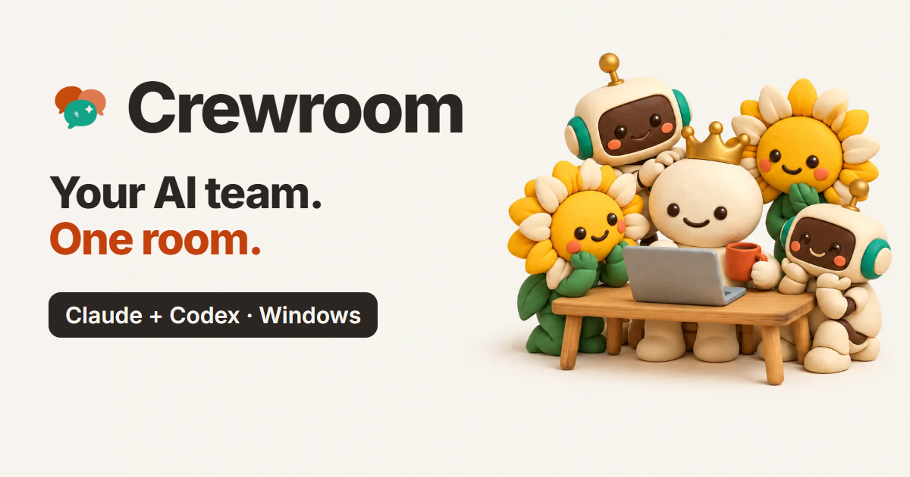

# Crewroom

**Your AI team, together.** Crewroom turns Claude Code and OpenAI Codex into one team on your computer (Windows, macOS or Linux). They hand work to each other, results land in one chat, and you lead.

▶ **[Watch the video (2:23) and see the site](https://karthus3560.github.io/crewroom/)**

## What it does
- **Hire a crew per project:** any mix of Claude and Codex members, each with its own roles, model and colour, and its own ongoing chat.
- **Real hand-offs:** an agent runs `team ask codex "Make 2 app icons" --run` and keeps working. When the job is done, the files and images land back in the chat. Codex askers get a note in their chat, and Claude waits with `team wait`.
- **Work in parallel:** different members work at the same time.
- **Producer:** write what you want in #general in plain words. The Producer sharpens it into orders and routes each one to the member that fits.
- **@mentions:** tag a member while it works. Codex and Claude both read your note between steps and adapt.
- **Safety net:**
  - While Crewroom is open, a Supervisor restarts a worker that died, retries a failure once, then asks for help.
  - When a hand-off chain runs too long, a Referee sorts it out, and anything past the limit waits for your OK. Nothing is dropped silently.
- **Your rules:** Claude members run commands only if you tick *Can run commands*. Common destructive ones (git push, rm -rf, Remove-Item, registry, shutdown) are refused. It's a guard-rail, not a sandbox. Codex works inside its own workspace sandbox.
- **One window:** projects, team chat with #general and #discussion, requests, galleries, and every agent's chat. Click a file path in a message to open it.

## Install (Windows 10/11, macOS, Linux)
1. You need:
   - **Python 3.10+**. Windows: [python.org](https://www.python.org/downloads/), tick *Add python.exe to PATH*. macOS: [python.org](https://www.python.org/downloads/macos/) or `brew install python`. Linux: your package manager.
   - at least one agent, signed in with your own plan: the **Claude** app ([claude.ai/download](https://claude.ai/download); open it once and switch to the **Code** tab) or Claude Code, and/or the **Codex** app ([chatgpt.com/codex](https://chatgpt.com/codex)) or Codex CLI.
2. Download the latest **[Crewroom zip](https://github.com/Karthus3560/crewroom/releases/latest/download/crewroom.zip)** and extract it. Keep the **Crewroom** folder somewhere permanent, for example `Documents`. Crewroom runs from that folder.
3. Run the installer for your system:

   | System | Install | Uninstall |
   |---|---|---|
   | Windows | double-click **`install.cmd`** | double-click `uninstall.cmd` |
   | macOS | double-click **`Install Crewroom.command`** | double-click `Uninstall Crewroom.command` |
   | Linux | `sh install.sh` | `sh uninstall.sh` |

   It adds the `team` skill to Claude and Codex and a way to open Crewroom: a Desktop and Start menu shortcut on Windows, **Crewroom** in Applications on macOS (Spotlight finds it), an app-menu entry on Linux.
   - Windows says *"Windows protected your PC"*? Click **More info → Run anyway**.
   - macOS says it can't check the file? Right-click it, choose **Open**, then **Open** again.
   These are unsigned scripts, and you can read them first (`install.py` does the work).
4. Open **Crewroom**, press **＋ New**, pick a folder, hire your crew.

Then just tell an agent: *"ask Codex to make 6 cozy icons for this app and tell me when they're done."*

### Updating, and knowing what's installed
- **Already have Crewroom?** The installer tells you which version is installed and where, and asks before replacing it. Install a new version the same way; it stops the old one and takes its place.
- **Which copy is running?** The bottom-left corner of the window shows the version and folder. Click it to see where your data is, how to uninstall, or to **Stop** Crewroom. Or run `team status`.
- Opening Crewroom always opens the copy you clicked. If a different copy was running, it is stopped first.
- **Moved the folder or updated Python?** Run the installer again.
- **Uninstalling** removes the skill and the shortcut. Your chats are kept in the data folder (below).
- **Window says "can't reach this page"?** See `logs/server.log` in the data folder. Another program may be using port 47800.

## Good to know
- **Privacy:** it runs on your machine. The app listens on `127.0.0.1:47800` only, and your mailbox stays in the data folder: `%USERPROFILE%\.crewroom` on Windows (1.0 used `%LOCALAPPDATA%\TeamChat`), `~/Library/Application Support/Crewroom` on macOS, `~/.local/share/crewroom` on Linux. Agents use **your own** Claude and ChatGPT plans, and their work goes to those providers as usual.
- **No packages:** Python's standard library only. The window is Edge or Chrome in app mode, or your default browser.
- **Reading chats:** Crewroom only *reads* the apps' own chat files (`~\.claude\projects`, `~\.codex\sessions`). When you set up a team it writes `TEAM.md` into the project and points `AGENTS.md`/`CLAUDE.md` at it.
- **Tests:** from the Crewroom folder, `python -m unittest tests.test_team`

## Credits
Designed by **Ghaith Saad Jawad**. Built with a Crewroom crew: Claude (code, film) and ChatGPT via Codex (art). The launch video's music is "Pixel Dreams" by DJ Lofi.

MIT licence.
